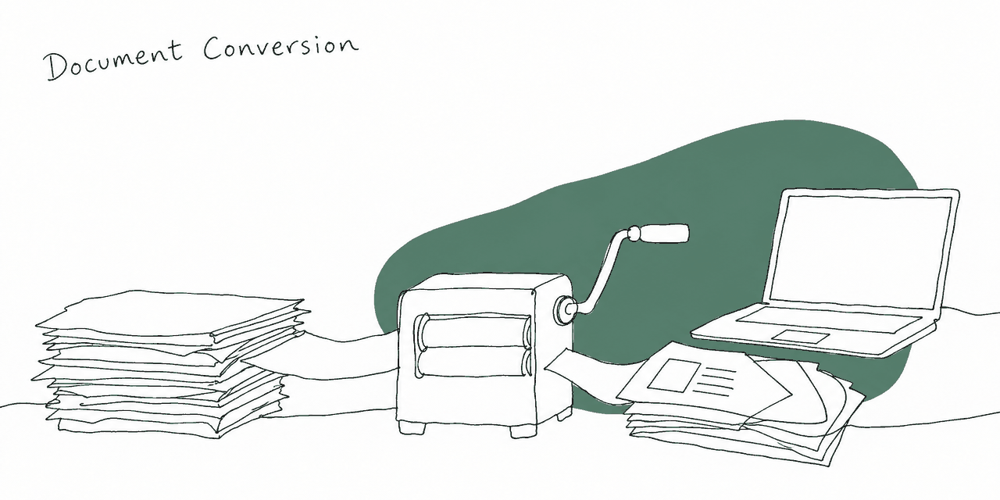

  

# Document Conversion Solutions

Three small tools for one recurring job: turning Markdown or structured text into Office documents. Built in 2023–2024 alongside my work at the University of Nicosia.

| Part | What it does | Stack |
| --- | --- | --- |
| [`python-api/`](python-api/) | Markdown → `.docx` and `.pptx` over HTTP: `POST /markdown_to_docx/`, `POST /markdown_to_pptx/` | Python, FastAPI, Docker |
| [`document-conversion/`](document-conversion/) | A web page that exports Markdown to Word or PowerPoint in the browser, or into a new Google Doc after you sign in with Google | Next.js, TypeScript, Google Docs API |
| [`officegen-api/`](officegen-api/) | A Node library and Express endpoint that build `.docx` files from a JSON description – titles, subtitles, lists, bullets, footnotes | Node.js, Express, officegen |

## Running a part

Each folder has its own README with setup steps:

- [Python API](python-api/README.md) – a virtual environment and `uvicorn`, or the Dockerfile
- [Web app](document-conversion/README.md) – `npm install`, then `npm run dev`
- [Officegen library and API](officegen-api/README.md) – with request and library examples in [`examples/`](officegen-api/examples/)

The repository also carries a dev container (`.devcontainer/`) if you'd rather not install anything locally.

## Status

Finished and not actively developed. Issues and pull requests are still welcome.

## License

[MIT](LICENSE)
